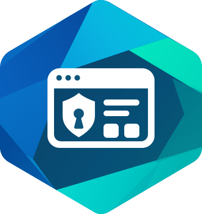

# Warden Web UI

<p align="center">
  
</p>

**A lightweight administration interface for [Keycloak Warden](https://github.com/gi8lino/keycloak-warden).**

Warden Web UI manages bans through Warden's administrative API. It stores administrators and sessions in its own SQLite database, without accessing Warden's enforcement database or exposing the API token to browsers.

## Features

- View active bans, append-only ban/release revision history, sources, and delivery acknowledgements.
- Inspect current enforcement delivery status across destinations, including failed releases.
- Browse user and administrative security incidents, view notification delivery attempts and retry exhausted notifications.
- Create manual bans and release existing bans.
- Inspect background worker state, delivery queue statistics, and database maintenance operations.
- Sign in with local accounts, Keycloak OIDC, or a trusted proxy.
- Manage administrators and choose from built-in themes.

## Quick start

Start the local demo with Warden, Hookglass, and the Web UI. Warden runs from a published container image; no second repository checkout is needed:

```sh
make e2e-up
```

Open [http://127.0.0.1:18092/setup](http://127.0.0.1:18092/setup) and create an administrator using the demo-only setup token `development-setup-token-0123456789abcdef`.

```sh
make e2e-logs  # Follow the services
make e2e-down  # Stop the demo
```

## Run locally

With Warden running, configure its admin token and a one-time setup token. WebUI uses the Warden Go client version pinned in `go.mod`:

```sh
export WARDEN_WEBUI__WARDEN_ADMIN_TOKEN='YOUR_WARDEN_ADMIN_TOKEN'
export WARDEN_WEBUI__SETUP_TOKEN="$(openssl rand -hex 32)"
make run
```

The Web UI URL is printed on startup. Set `WARDEN_WEBUI__WARDEN_URL` if Warden is not available at `http://127.0.0.1:8080`. Configuration is available through CLI flags and `WARDEN_WEBUI__` environment variables; run `go run ./cmd/warden-webui --help` for the full reference.

## Documentation

Full documentation is available at **[gi8lino.github.io/keycloak-warden-webui](https://gi8lino.github.io/keycloak-warden-webui/)**.

- [Getting started](https://gi8lino.github.io/keycloak-warden-webui/getting-started/)
- [Configuration](https://gi8lino.github.io/keycloak-warden-webui/configuration/)
- [Authentication](https://gi8lino.github.io/keycloak-warden-webui/authentication/)
- [Deployment](https://gi8lino.github.io/keycloak-warden-webui/deployment/)

## Deployment

Kubernetes manifests support both [sidecar and standalone deployments](deploy/kubernetes/README.md) using Kustomize. The [Docker Compose configuration](test/e2e/compose.yaml) provides a local integration environment.

For production, use HTTPS for browser access, keep the Warden admin token in a Secret, and provide persistent storage for the Web UI's SQLite database. Authentication is always required.

## License

Licensed under the [Apache License, Version 2.0](LICENSE).

## Operational visibility

The Deliveries page includes aggregate destination health, with exhausted unbans prioritized. Retry buttons on exhausted current deliveries submit the exact decision revision and the authenticated local account name to Warden. Decision details link to the chronological source, decision, attempt and retry audit view. The Incidents page includes hypothetical automatic bans recorded by Warden in observe-only mode. Notifications has its own occurrence history and retry controls.

Keep the Warden client dependency and E2E image in `test/e2e/compose.yaml` on the same release (currently v0.50.1). This Web UI requires the incidents, notifications, and enforcement-worker APIs. Upgrade Warden and Web UI together. Existing `/observations` bookmarks open the Incidents page. Set `E2E_WARDEN_IMAGE` to test another compatible Warden image.

See [E2E tests](test/e2e/README.md) for `make e2e-test` (real Warden stack) and `make e2e-auth-test` (browser authentication and UI fixtures).
