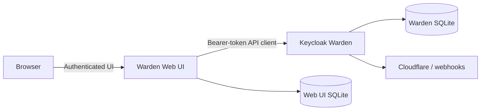

# Architecture

Warden Web UI is deliberately separate from Warden's detection and enforcement engine. It is an administrative frontend with its own authentication state and a **server-to-server** Warden client.

## Responsibility boundaries

- **Warden** owns the security event receiver, detection policy, automatic and manual ban decisions, ban expiry, retries, and destination delivery.
- **Web UI** owns browser authentication, its own administrator records and sessions, page rendering, and requests to Warden's administrative API.
- **Browsers** receive only HTML, CSS, and a session cookie. Warden's administrator bearer token stays in the Web UI process.

Web UI is a server-rendered Go application with embedded assets and minimal progressive JavaScript. Account/session data lives in a private SQLite file unrelated to Warden's own enforcement database.

## Listener and deployment models

The application listener serves the UI and static files; the management listener serves health and readiness. Web UI can run beside Warden in a single Kubernetes Pod (loopback upstream) or independently (HTTPS upstream). Both use **separate** SQLite storage.

For setup and security configuration, see [Authentication](authentication.md) and [Deployment](deployment.md).
