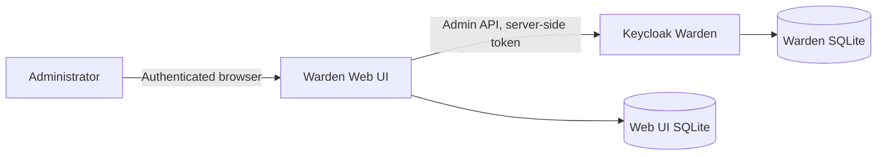

# Warden Web UI

**Manage Keycloak Warden bans from an authenticated browser interface.**

Warden Web UI is a small, optional companion to [Keycloak Warden](https://github.com/gi8lino/keycloak-warden). It uses Warden's administrative API to display active decisions, release or create bans, and inspect maintenance status. It does not access Warden's enforcement database or expose its administrative token to the browser.

## What you can do

- **Manage bans:** list effective bans, create manual bans, inspect details and release bans.
- **Investigate delivery:** view sources, revisions, and destination acknowledgements.
- **Run maintenance:** inspect housekeeping and manually request observation pruning or SQLite optimization.
- **Choose authentication:** local administrators, Keycloak OIDC, or a trusted identity proxy.
- **Manage accounts:** provision local users and approve verified external identities.
- **Personalize the UI:** choose from 16 embedded color themes or provide a custom TOML palette.

## Get started

1. [Run the Compose demo](getting-started.md) with Warden and Hookglass.
2. [Configure the Web UI](configuration.md) and [choose authentication](authentication.md).
3. [Deploy with Kustomize](deployment.md) as a Warden sidecar or standalone service.

For day-to-day workflows, see [Administration](administration.md), [Operations](operations.md), and [Themes](themes.md).

[Browse the source on GitHub](https://github.com/gi8lino/keycloak-warden-webui) · [View releases](https://github.com/gi8lino/keycloak-warden-webui/releases)
